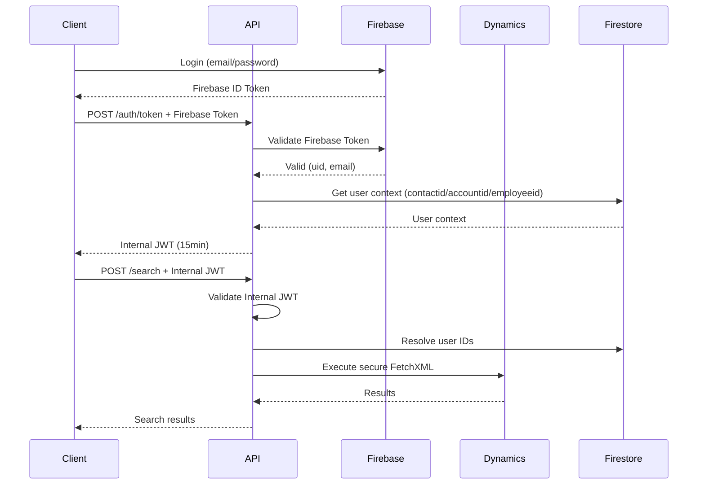

# Api.Web.ServiciosFinancieros - Multi-Tenant API Template

**ASP.NET Core 8 multi-tenant API template** with Firebase authentication, Dynamics 365 integration, secure search, and production-ready features.

## 🎯 What's Included

This template provides a complete, production-ready foundation for building multi-tenant APIs that integrate with:
- **Firebase Authentication** (B2C, B2B, employee support)
- **Dynamics 365** (OData + FetchXML)
- **Google Cloud Firestore** (user context resolution)

### ✅ Core Features

- ✅ **Multi-tenant architecture** - Tenant resolution from header or JWT claims
- ✅ **Dual authentication** - Firebase tokens + Internal JWT (SmartJwt policy)
- ✅ **Secure search system** - Server-side FetchXML with automatic Row-Level Security (RLS)
- ✅ **Rate limiting** - Per-user (150/min) and dynamic per-tenant limits
- ✅ **Health checks** - `/health` (liveness) and `/ready` (readiness with dependencies)
- ✅ **Global exception handling** - RFC 7807 ProblemDetails
- ✅ **Three user types** - Contact (B2C), Account (B2B), Employee (internal)
- ✅ **Production security** - AES-256 encryption, MSAL auth, reCAPTCHA V3

### 🏗️ Architecture

```
┌─────────────────────────────────────────────────────────────┐
│                    Client Application                        │
│              (Web, Mobile, Desktop, Portal)                  │
└─────────────────────────────────────────────────────────────┘
                            │
                            │ HTTPS + JWT
                            ▼
┌─────────────────────────────────────────────────────────────┐
│               API (This Template)                            │
│  ┌──────────────────────────────────────────────────────┐  │
│  │ Middleware Pipeline                                   │  │
│  │  1. TenantResolution (X-Tenant-ID or JWT)            │  │
│  │  2. Authentication (Firebase or Internal JWT)        │  │
│  │  3. TenantFromJwt (fallback tenant resolution)       │  │
│  │  4. RateLimiting (150/min user, dynamic tenant)      │  │
│  │  5. Authorization                                     │  │
│  └──────────────────────────────────────────────────────┘  │
│                                                              │
│  Controllers:                                                │
│   • BffController - Token exchange, onboarding              │
│   • SearchController - Secure search with RLS               │
│   • ConsultaFetchController - Legacy FetchXML (admin)       │
└─────────────────────────────────────────────────────────────┘
            │                    │                    │
            ▼                    ▼                    ▼
    ┌──────────────┐   ┌──────────────┐   ┌──────────────┐
    │   Firebase   │   │  Dynamics    │   │  Firestore   │
    │ Multi-tenant │   │  365 OData   │   │ User Context │
    └──────────────┘   └──────────────┘   └──────────────┘
```

### 🔐 Authentication Flow



---

## 🚀 Quick Start

### Prerequisites

- **.NET 8 SDK** - [Download](https://dotnet.microsoft.com/download/dotnet/8.0)
- **SQL Server** - Azure SQL or local instance
- **Firebase Project** - [Console](https://console.firebase.google.com)
- **Dynamics 365** - With OAuth app registration
- **Google Cloud Firestore** - For user context storage

### 1. Clone and Setup

```bash
# Clone the template
git clone <repository-url>
cd Api.Web.ServiciosFinancieros

# Restore dependencies
dotnet restore

# Set up user secrets
dotnet user-secrets init
dotnet user-secrets set "ConnectionStrings:Default" "Server=YOUR_SERVER;Database=YOUR_DB;User Id=YOUR_USER;Password=YOUR_PASSWORD;TrustServerCertificate=true"
dotnet user-secrets set "Jwt:SigningKey" "your-secure-32-character-minimum-signing-key-here"
dotnet user-secrets set "ENCRYPTION_MASTER_KEY" "your-secure-32-character-minimum-encryption-key"
```

### 2. Database Setup

Run the database schema creation scripts (see `/docs/guides/setup.md` for details):

```sql
-- Create tables
CREATE TABLE Credenciales (...);
CREATE TABLE TenantFirebaseConfig (...);
CREATE TABLE ErrorLogs (...);
```

### 3. Configure Tenant

Insert your tenant configuration (encrypted credentials):

```bash
# Use the EncryptionHelper tool
cd EncryptionHelper
dotnet run -- encrypt "your-dynamics-client-secret"
# Copy the encrypted value to SQL insert
```

### 4. Configure Application

Edit `appsettings.json`:

```json
{
  "Jwt": {
    "Issuer": "https://api.yourcompany.com",
    "Audience": "yourapi-client",
    "AccessTokenMinutes": 15
  },
  "Cors": {
    "AllowedOrigins": ["https://yourfrontend.com"]
  }
}
```

### 5. Run

```bash
dotnet run
```

The API will be available at:
- `http://localhost:5079` (HTTP)
- `https://localhost:7269` (HTTPS)

---

## 📡 API Endpoints

### Authentication

| Endpoint | Method | Auth | Description |
|----------|--------|------|-------------|
| `/api/bff/auth/token` | POST | Firebase | Exchange Firebase token for Internal JWT |
| `/api/bff/auth/onboarding-token` | POST | reCAPTCHA | Get anonymous JWT for onboarding |

### Search

| Endpoint | Method | Auth | Description |
|----------|--------|------|-------------|
| `/api/search` | POST | JWT | Secure search with automatic RLS |

### Legacy (Admin Only)

| Endpoint | Method | Auth | Description |
|----------|--------|------|-------------|
| `/api/consultafetch/ejecutar` | POST | JWT | Execute FetchXML (auto-pagination) |
| `/api/consultafetch/ejecutar-paginado` | POST | JWT | Execute FetchXML (manual pagination) |

### Health

| Endpoint | Method | Auth | Description |
|----------|--------|------|-------------|
| `/health` | GET | None | Simple liveness check |
| `/ready` | GET | None | Detailed readiness with dependency checks |

---

## 🔒 Security Features

### Row-Level Security (RLS)

All searches automatically filter results based on user identity:

```json
// Client sends
{
  "entity": "contact",
  "select": ["fullname", "emailaddress1"],
  "filters": [{"field": "address1_city", "op": "Eq", "value": "Buenos Aires"}]
}

// Server builds FetchXML with injected security filter
<fetch>
  <entity name='contact'>
    <attribute name='fullname'/>
    <attribute name='emailaddress1'/>
    <filter type='and'>
      <!-- INJECTED BY SERVER - CLIENT CANNOT REMOVE -->
      <condition attribute='ownerid' operator='eq' value='{user-contactid}'/>
      <!-- Client's filter -->
      <condition attribute='address1_city' operator='eq' value='Buenos Aires'/>
    </filter>
  </entity>
</fetch>
```

### Rate Limiting

- **Per User**: 150 requests/minute
- **Per Tenant**: Dynamic (active_users × 150) with 1000/min cap
- **Anonymous**: 5 requests/minute (onboarding endpoint)

Rate limit headers in every response:
```
X-RateLimit-Limit-User: 150
X-RateLimit-Remaining-User: 87
X-RateLimit-Reset-User: 1672531245
X-RateLimit-Limit-Tenant: 450
X-RateLimit-Remaining-Tenant: 320
```

### Encryption

- **AES-256-CBC** for sensitive data at rest (DB)
- **HMAC-SHA256** for JWT signing
- Master key from environment/user secrets (never in code)

---

## 📚 Documentation

Detailed guides are available in `/docs/guides/`:

- **[setup.md](docs/guides/setup.md)** - Complete setup walkthrough
- **[template-usage.md](docs/guides/template-usage.md)** - How to fork and adapt this template
- *More guides in development...*

---

## 🏗️ Project Structure

```
Api.Web.ServiciosFinancieros/
├── Clases/                         # Core infrastructure
│   ├── Authentication/             # Firebase + JWT handlers
│   ├── Middleware/                 # Tenant, Rate Limiting, etc.
│   ├── Exceptions/                 # Custom exception types
│   └── Services/                   # Core services
│
├── Controllers/                    # API endpoints
│   ├── BffController.cs           # Auth token exchange
│   ├── SearchController.cs        # Secure search
│   └── ConsultaFetchController.cs # Legacy FetchXML
│
├── Data/                          # Database access
│   ├── AppDbContext.cs           # EF Core context
│   └── Repositories/             # Data repositories
│
├── Models/                        # DTOs and models
│   ├── TenantContext.cs          # Tenant configuration
│   ├── UserContext.cs            # User identity
│   └── SearchModels.cs           # Search request/response
│
├── Servicios/                     # Business services
│   ├── DynamicsClient.cs         # Dynamics 365 client
│   ├── RateLimiting/             # Rate limit service
│   ├── HealthChecks/             # Health check implementations
│   └── ...                       # Other services
│
├── docs/                          # Documentation
│   └── guides/                   # Setup and usage guides
│
└── EncryptionHelper/             # CLI tool for encrypting secrets
```

---

## 🔧 Technology Stack

- **ASP.NET Core 8** (.NET 8.0), C# 12
- **Azure SQL Server** (Database First, NO migrations)
- **Firebase Admin SDK** (multi-tenant)
- **Dynamics 365** OData v9.2 (MSAL client credentials)
- **Google Cloud Firestore** (user context resolution)
- **System.Text.Json** (NO Newtonsoft.Json)
- **IMemoryCache** (rate limiting)

---

## 🧪 Testing

```bash
# Health checks
curl http://localhost:5079/health
curl http://localhost:5079/ready

# Get Internal JWT
curl -X POST http://localhost:5079/api/bff/auth/token \
  -H "X-Tenant-ID: your-tenant-id" \
  -H "Authorization: Bearer {firebase-id-token}"

# Search (with Internal JWT)
curl -X POST http://localhost:5079/api/search \
  -H "X-Tenant-ID: your-tenant-id" \
  -H "Authorization: Bearer {internal-jwt}" \
  -H "Content-Type: application/json" \
  -d '{
    "entity": "contact",
    "select": ["fullname", "emailaddress1"],
    "page": 1,
    "pageSize": 10
  }'
```

---

## 🚢 Deployment

For Azure deployment guide, see `/docs/guides/deployment-azure.md` (coming soon).

Quick checklist:
- [ ] Set production connection strings in Azure App Service configuration
- [ ] Configure Key Vault for secrets (JWT keys, encryption keys)
- [ ] Enable Application Insights for monitoring
- [ ] Configure CORS for production domains
- [ ] Set reCAPTCHA threshold to 0.5
- [ ] Review rate limits for production load

---

## 🤝 Contributing

This is a template project. Fork it and adapt it to your needs!

When you make improvements that are generic and reusable:
1. Create a feature branch
2. Implement the improvement
3. Test thoroughly
4. Submit a PR to the template repository

---

## 📄 License

[Your License Here]

---

## 🆘 Support

For issues with the template itself, open an issue on GitHub.

For project-specific customizations, refer to your project's documentation.

---

## 🎯 Next Steps

1. **Fork this template** for your new project
2. **Rename namespaces** (Api.Web.ServiciosFinancieros → Your.Project.Name)
3. **Configure your tenant** (Firebase, Dynamics, database)
4. **Extend MetaRegistry** with your Dynamics entities
5. **Add custom business logic** in new controllers/services
6. **Deploy to your infrastructure**

See `/docs/guides/template-usage.md` for detailed fork instructions.

---

**Built with ❤️ using ASP.NET Core 8**
